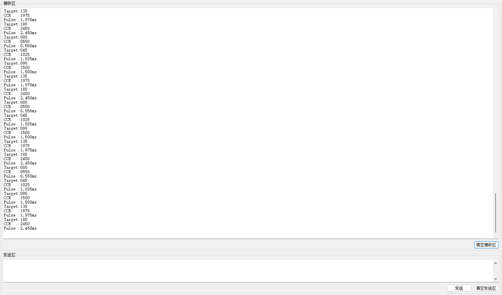

# 第四次培训作业 · PWM 驱动 SG90 舵机

姓名：宋宇乐　　　　学号：20263004494　　　　班级：机械2班

## 一、任务

用 TIM2_CH1 输出 50Hz PWM，驱动 SG90 转过 0° / 45° / 90° / 135° / 180°，
OLED 显示“目标角度 / CCR / 脉宽”，串口同步打印。

## 二、参数推导

- 定时器：TIM2，挂在 APB1 上，实际计数时钟 **72 MHz**
- 让 1 个计数 = 1 µs → PSC = 71
- 周期 20 ms → ARR = 19999

验算：

```
72MHz ÷ (71+1) ÷ (19999+1) = 72M ÷ 72 ÷ 20000 = 50 Hz
```

## 三、角度与脉宽

| 角度 | 脉宽 | CCR |
|---|---|---|
| 0° | 550 µs | 550 |
| 45° | 1025 µs | 1025 |
| 90° | 1500 µs | 1500 |
| 135° | 1975 µs | 1975 |
| 180° | 2450 µs | 2450 |

**两端为什么取 550 / 2450：** 名义值是 500 / 2500，实测打满会顶到机械限位、咔咔响，
所以两端各留约 2° 的余量。

## 四、接线

| 信号 | 接到 |
|---|---|
| 舵机 橙（信号） | PA0 |
| 舵机 红（VCC） | 独立 5V 电源 + |
| 舵机 棕（GND） | 独立 5V 电源 −（与板子 GND 相连） |
| OLED SCL / SDA | PB8 / PB9 |
| CH340 TX / RX | PA10 / PA9 |

## 五、运行现象




## 六、遇到的问题

for循环会卡死主循环 

中断里面刷OLED会导致OLED乱码 

中断里面不能用HAL_Delay 会死机

 定时器中断函数的里的一些变量要加static

 uint8_t 此类变量不取负值
